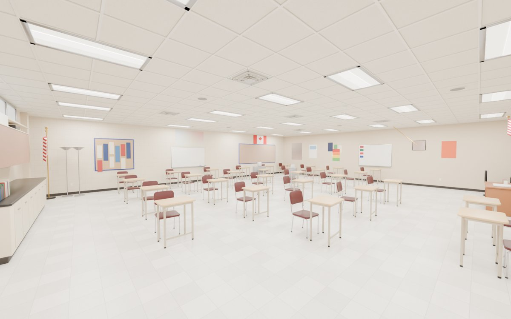
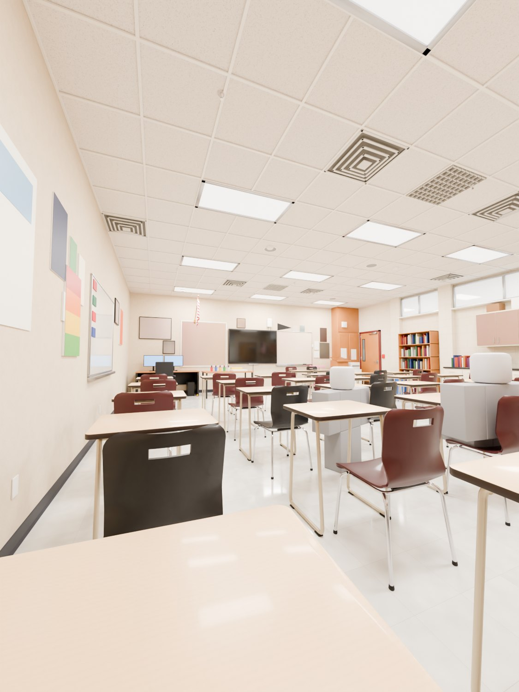
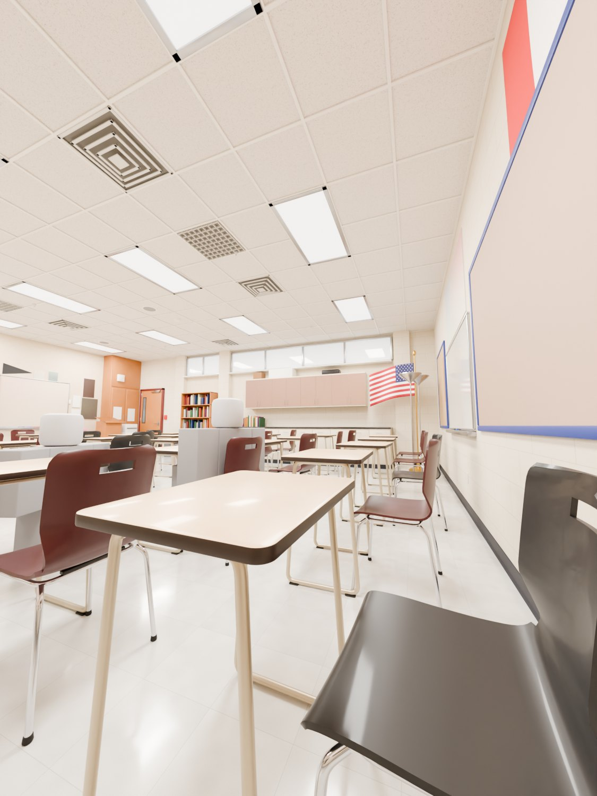
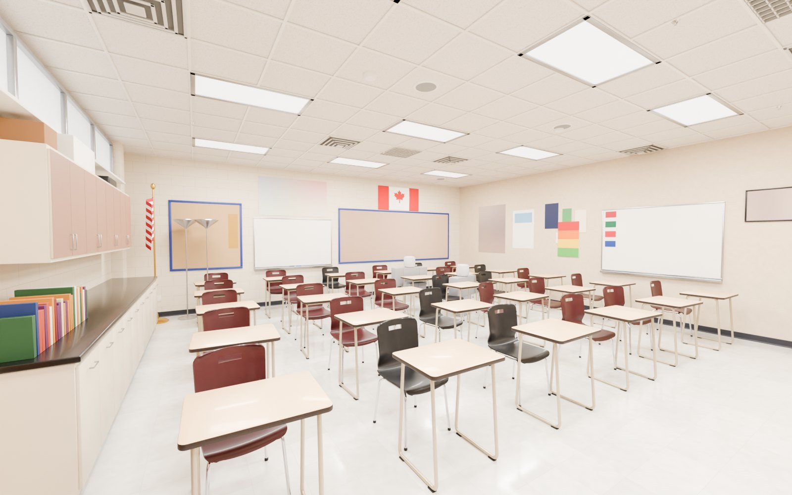
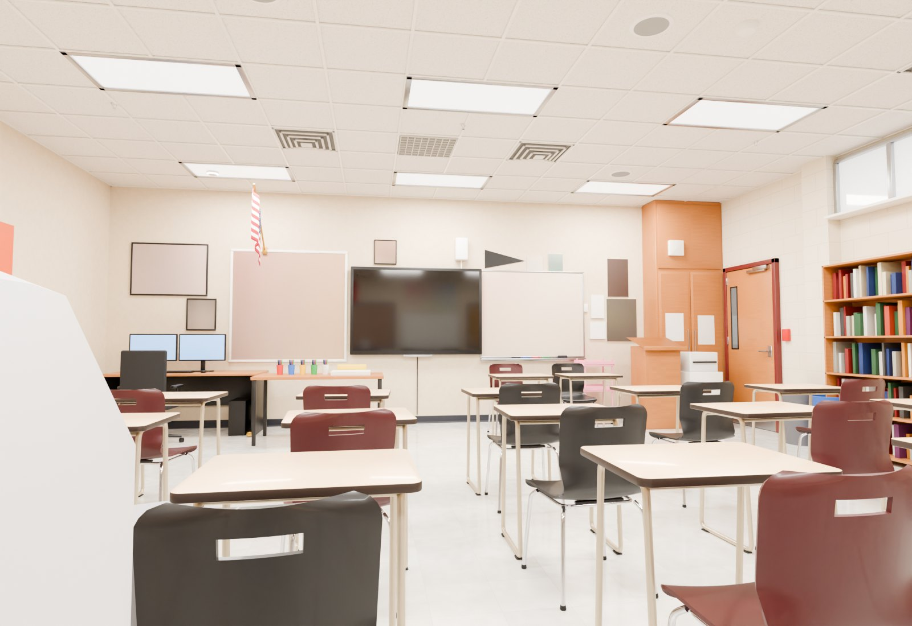
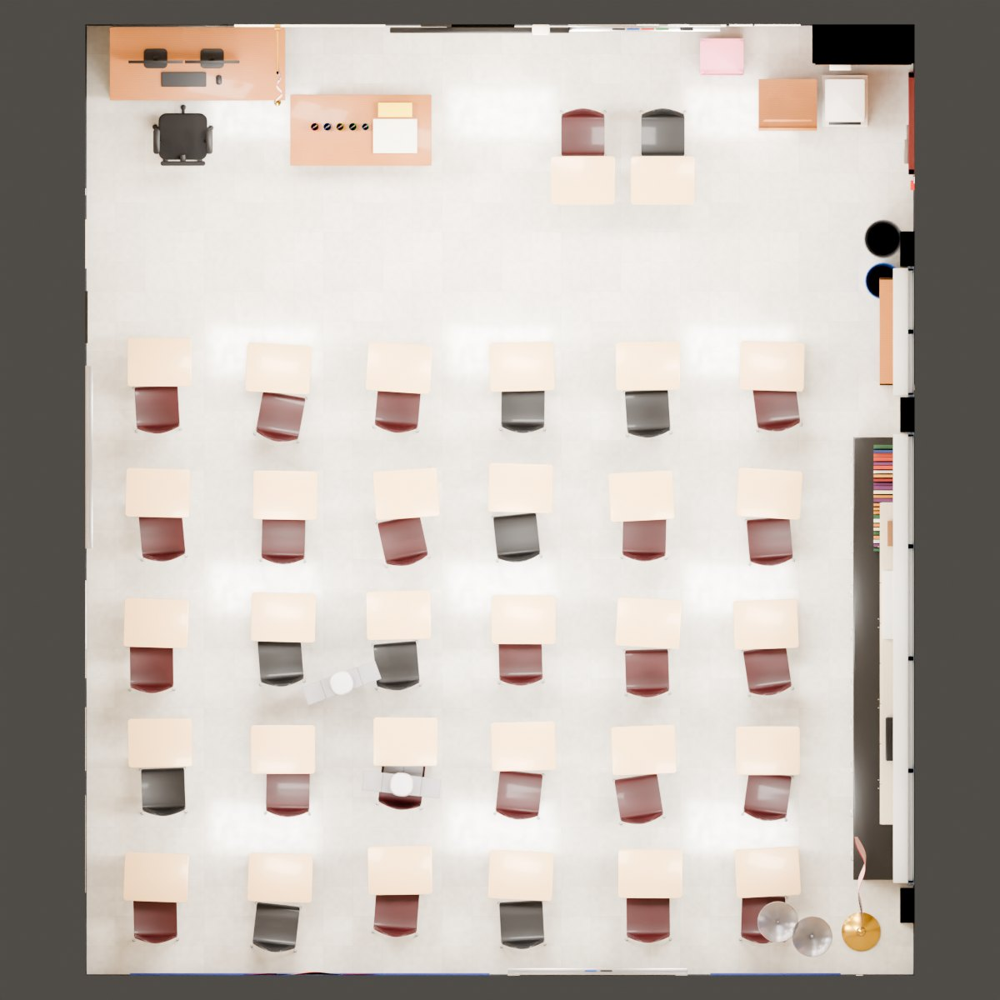
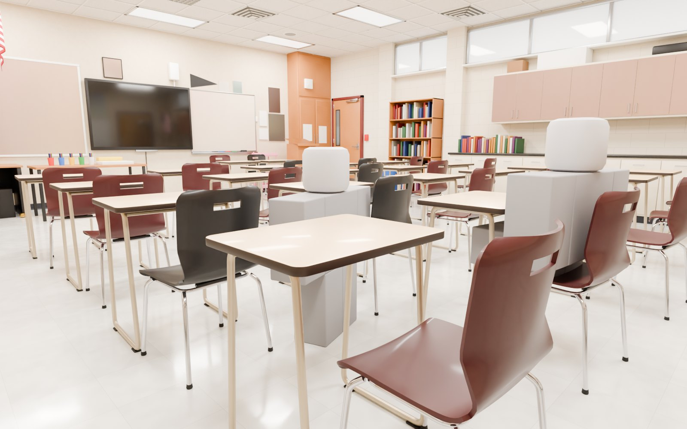
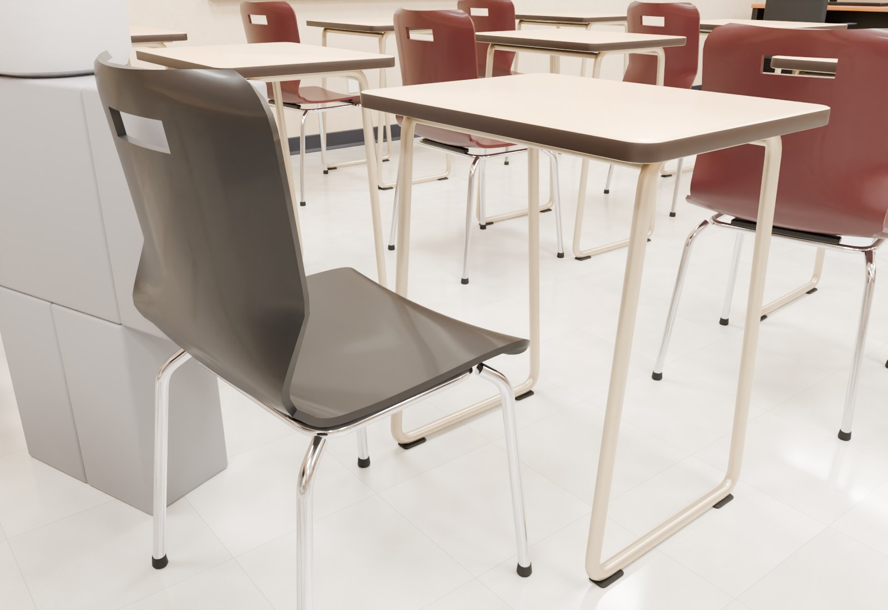
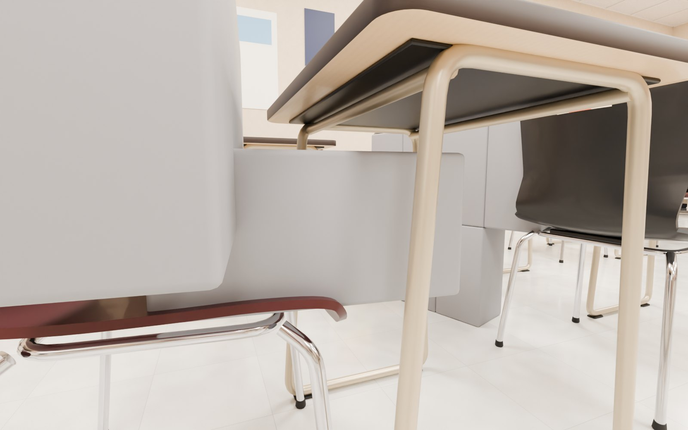
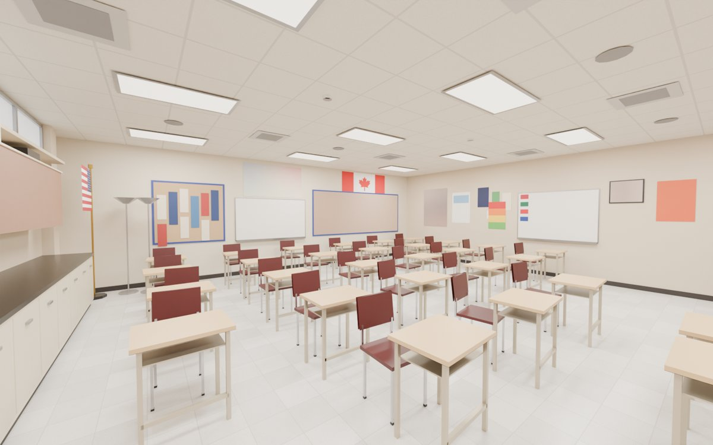

# Empty Classroom

## HD version for Roblox (true to life, R6 scale)

**Download:** [classroom_hd.zip](https://github.com/155xp/empty-classroom-model/releases/latest/download/classroom_hd.zip)

About 392k triangles. The room is modeled 1:1 from the photos (8.5 x 9.75 m, 3.2 m ceiling) with real furniture sizes. `classroom_roblox.glb` is already in studs (1 m = 5 studs, so a seated R6 matches a seated student; room is about 42.5 x 49 x 16 studs) and split into 413 single-material parts under Roblox's 20k-triangle limit. Also includes the Blender source in meters.

### Renders

**Front wall from the back row**

**Cabinet wall from the back row**

**Back wall from the front corner**

**Front wall up close**

**Top-down layout**

**R6 scale check (grey blocks are R6 dummies)**

**Desk and chair close-up**

**Seated R6 from the side, legs clear the desk**

## Original low-poly version

Low-poly 3D model of a classroom (about 10.6k triangles), rebuilt from photos with the students removed.

**Download:** [classroom.zip](https://github.com/155xp/empty-classroom-model/releases/download/v1/classroom.zip) (3.4 MB)

In the zip:
- `classroom.blend`: Blender 5.2 file, textures packed in, with cameras and ceiling lights
- `classroom.glb`: for game engines and the web (three.js, Unity, Godot). Meters, Y up. Add your own lights.
- `textures/`: the wall-decor and tile textures as JPGs
- `renders/`: preview renders
