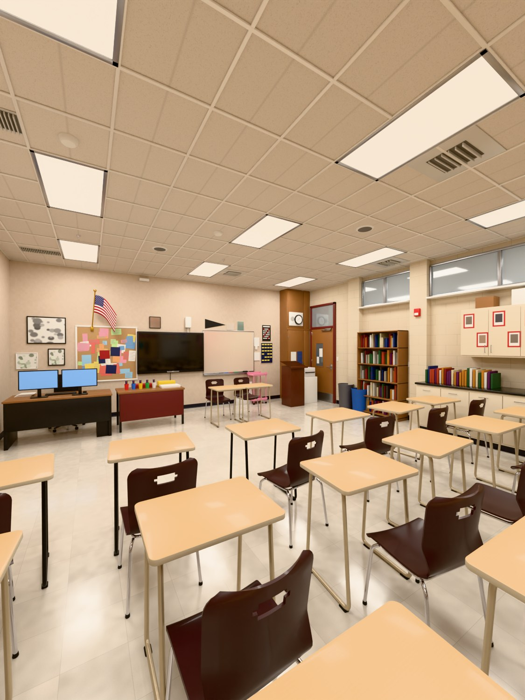
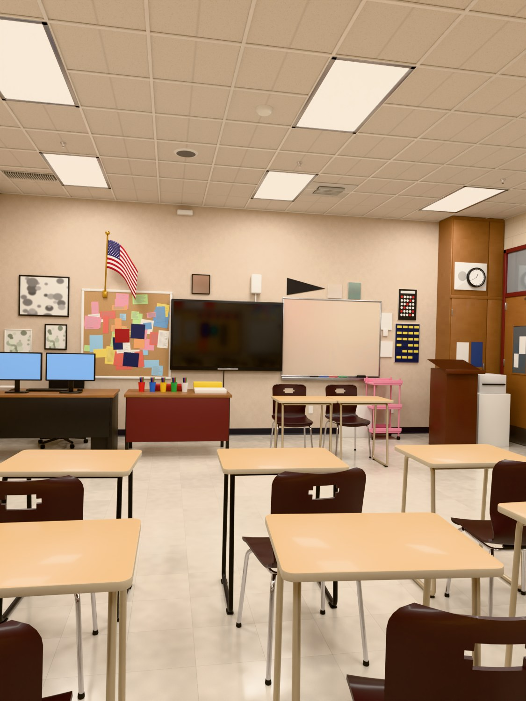
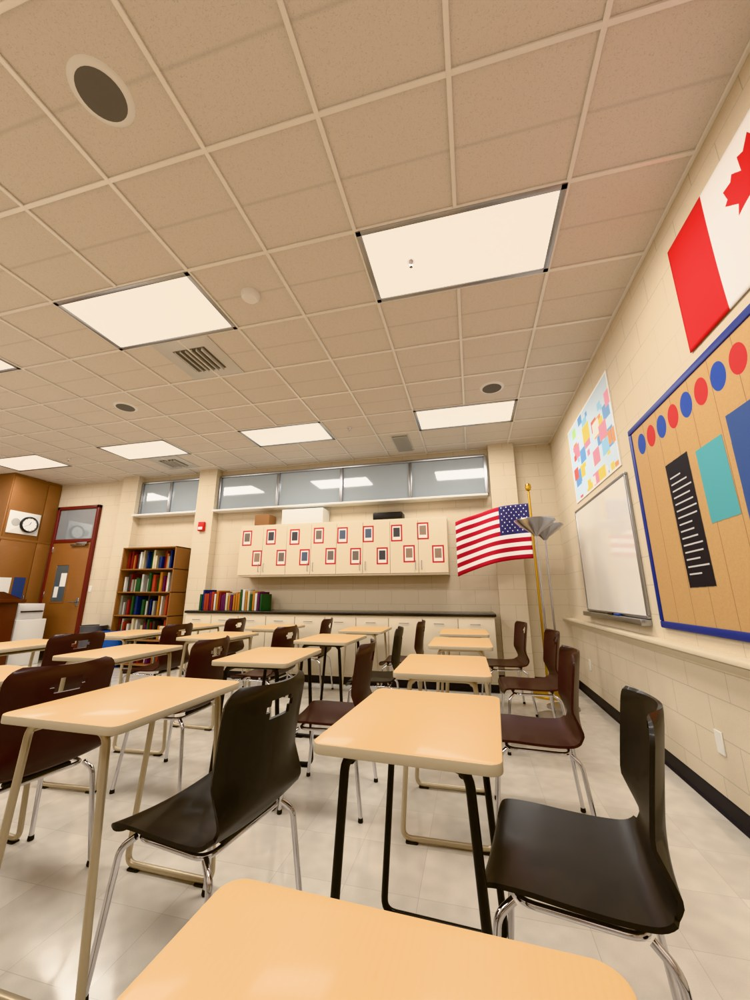
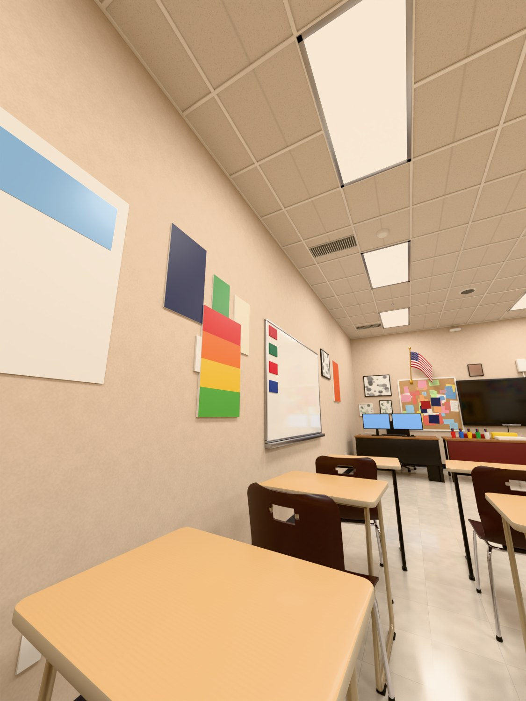
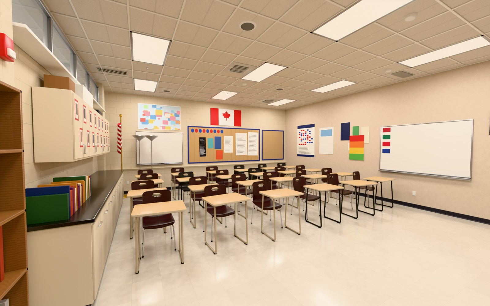
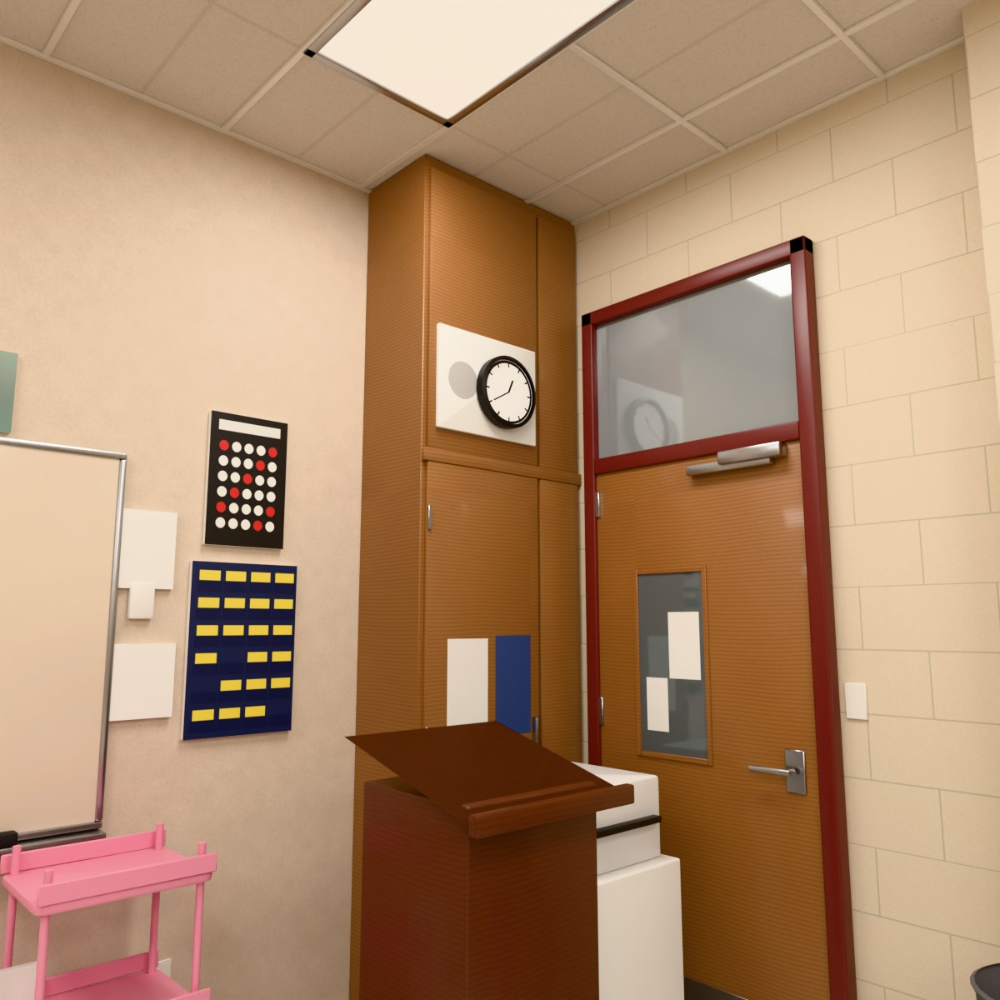
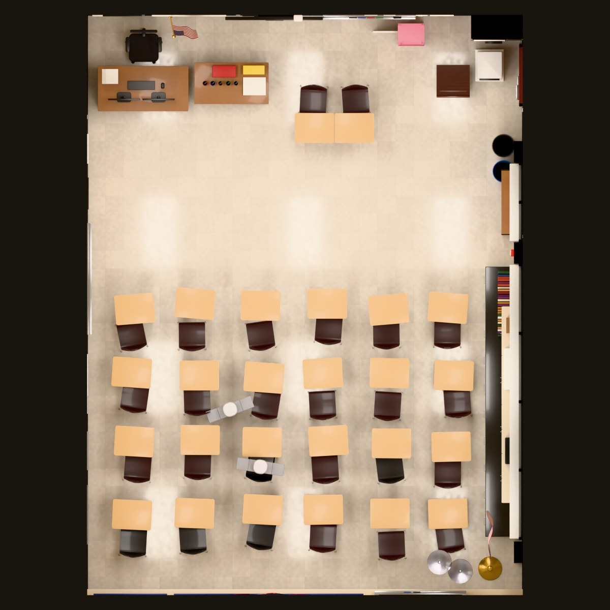

# Empty Classroom

## HD version for Roblox (true to life, R6 scale)

**Download:** [classroom_hd.zip](https://github.com/155xp/empty-classroom-model/releases/latest/download/classroom_hd.zip)

About 325k triangles. The room is 7.32 x 9.75 m (24 x 32 ft) with a 3.35 m ceiling, re-measured from the photos: ceiling tiles were counted along the front wall, then the cameras and front-wall layout were solved together from two photos (about 3 px error). Desks, TV, whiteboard, oak cabinet, clock, door and the 3 x 4 grid of 2x4 lights sit where the photos put them. Posters and boards are generic stand-ins. `classroom_roblox.glb` is already in studs (1 m = 5 studs, so a seated R6 matches a seated student; room is about 36.6 x 48.8 x 16.8 studs) and split into 366 single-material parts under Roblox's 20k-triangle limit. Also includes the Blender source in meters.

### Renders

**Front wall from the back row (same angle as photo IMG_0074)**

**Front wall, 1x lens from the back row (same angle as IMG_0079)**

**Toward the door and cabinets (same angle as IMG_0075)**

**Window wall with the back-wall boards on the right (same angle as IMG_0078)**

**Left wall looking toward the front (same angle as IMG_0076)**

**Whole room from the back wall**

**Back wall from the front corner**

**Oak cabinet with the PA speaker and clock, door with transom**

**Desk and chair close-up (grey blocks are R6 dummies)**

**R6 scale check (grey blocks are R6 dummies)**

**Top-down layout**

## Original low-poly version

Low-poly 3D model of a classroom (about 10.6k triangles), rebuilt from photos with the students removed.

**Download:** [classroom.zip](https://github.com/155xp/empty-classroom-model/releases/download/v1/classroom.zip) (3.4 MB)

In the zip:
- `classroom.blend`: Blender 5.2 file, textures packed in, with cameras and ceiling lights
- `classroom.glb`: for game engines and the web (three.js, Unity, Godot). Meters, Y up. Add your own lights.
- `textures/`: the wall-decor and tile textures as JPGs
- `renders/`: preview renders
