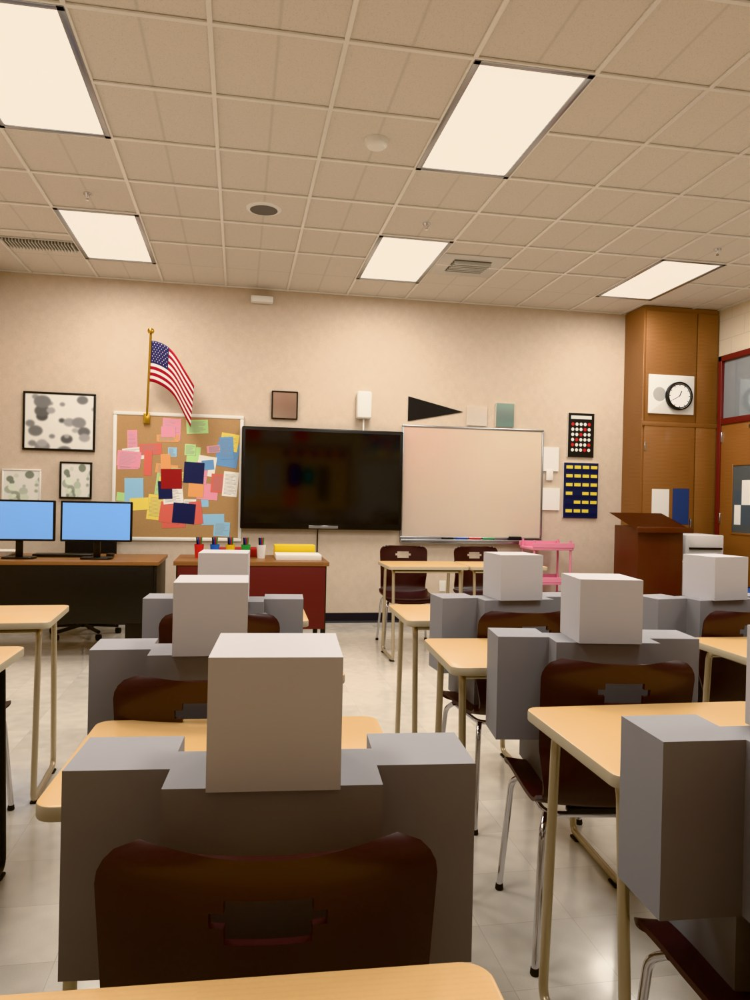
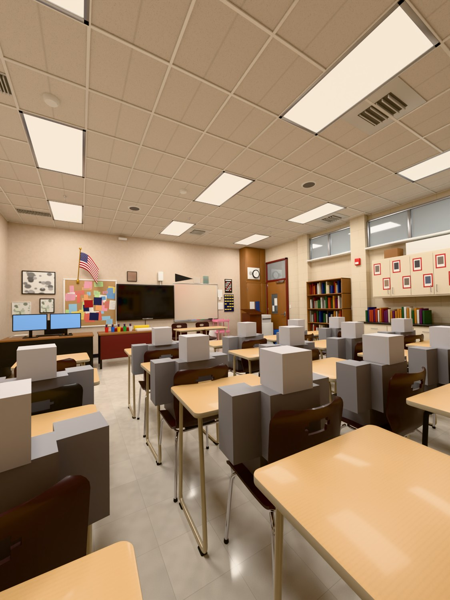
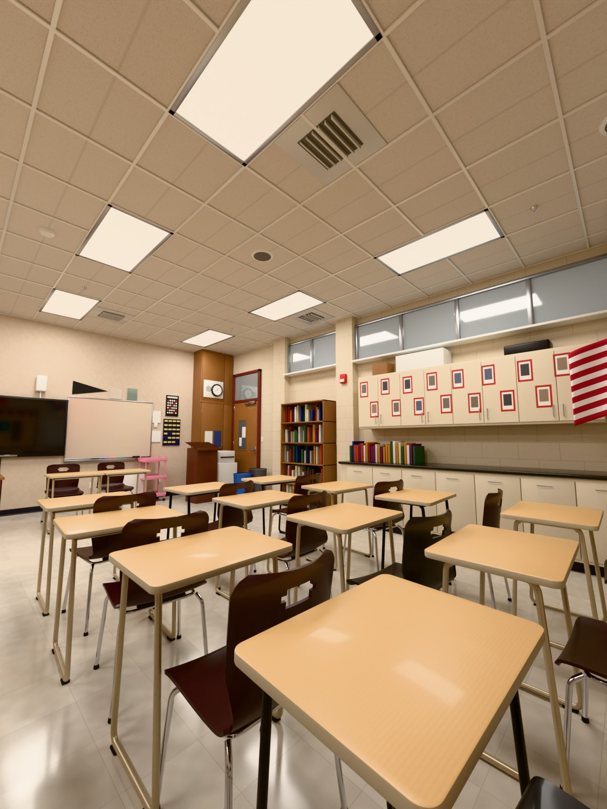
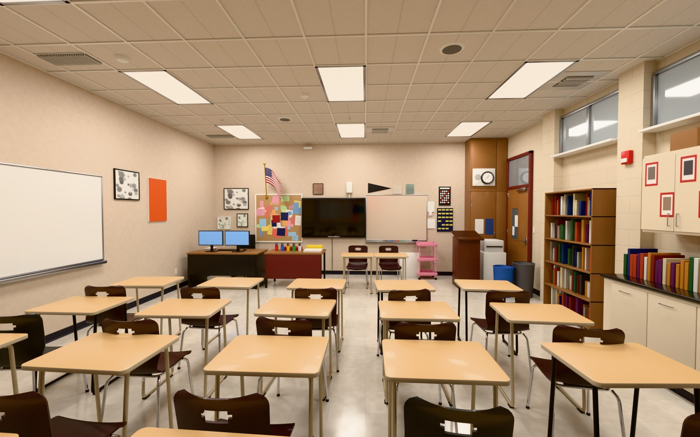
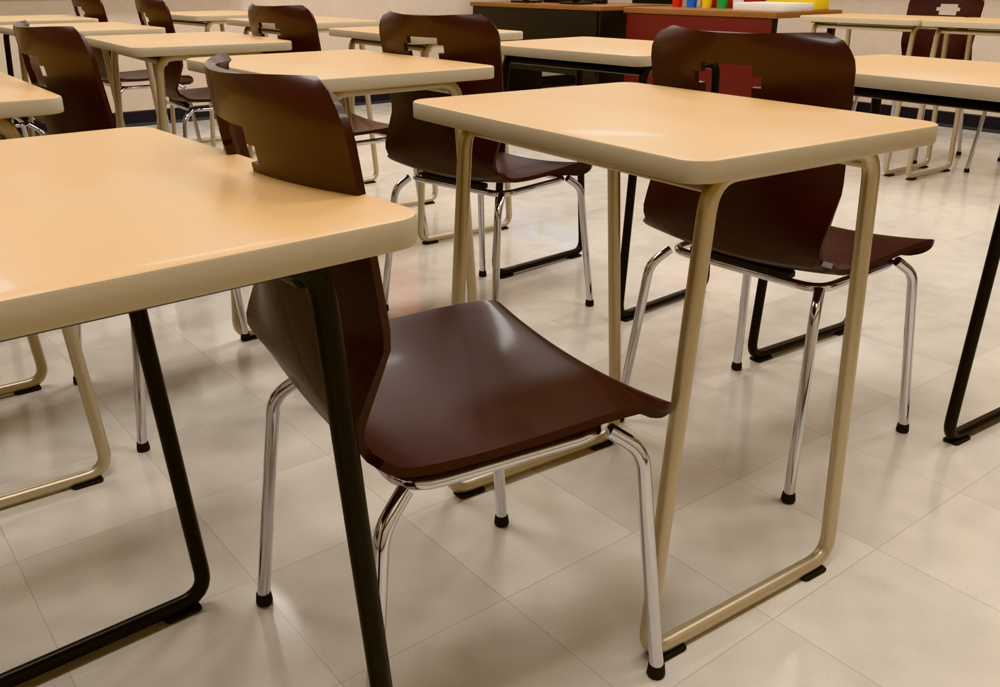
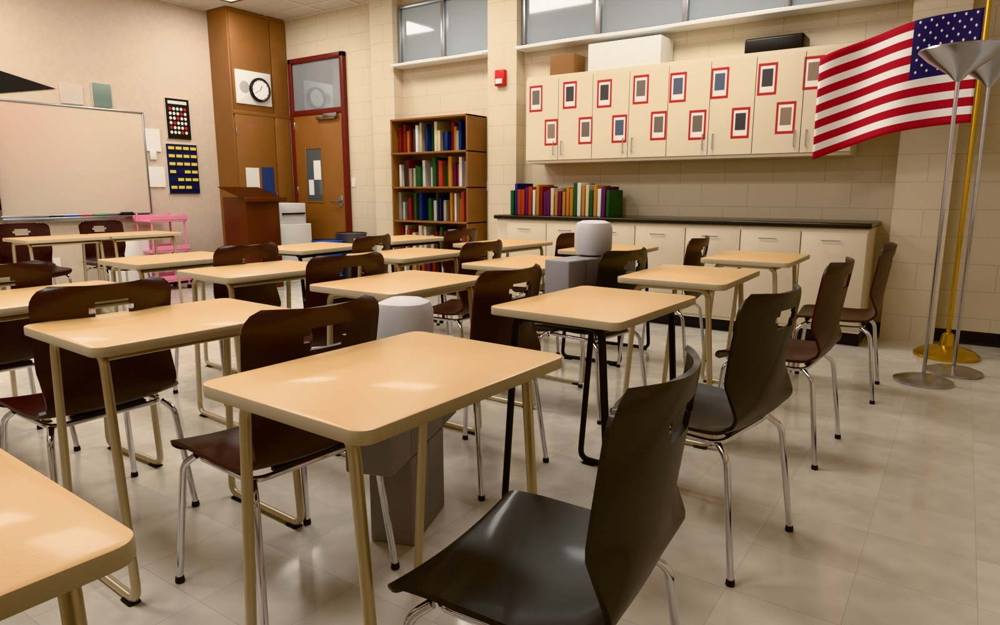

# Empty Classroom

## HD version for Roblox (true to life, R6 scale)

**Download:** [classroom_hd.zip](https://github.com/155xp/empty-classroom-model/releases/latest/download/classroom_hd.zip)

About 283k triangles. The room is 7.32 x 8.53 m (24 x 28 ft) with a 3.38 m ceiling, measured from the photos: ceiling tiles counted along the front wall, cameras and front-wall layout solved together from two photos (about 3 px error), and the desk grid (5 columns about 1.05 m apart, 4 rows about 0.95 m apart) located from where the students and their laptops sit. Posters and boards are generic stand-ins. `classroom_roblox.glb` is already in studs at **1 m = 6.5 studs**, so an R6 head is the size of the students' heads in the photos (room is about 47.6 x 55.4 x 22 studs). It is split into 329 single-material parts under Roblox's 20k-triangle limit. Also includes the Blender source in meters.

### Renders

**Seated R6s at the desks, same angle as IMG_0079 (R6 heads match the students' heads)**

**Seated R6s at the desks, same angle as IMG_0074**

**Front wall from the back row (same angle as IMG_0074)**

**Front wall, 1x lens from the back row (same angle as IMG_0079)**

**Toward the door and cabinets (same angle as IMG_0075)**

**Window wall with the back-wall boards on the right (same angle as IMG_0078)**

**Left wall looking toward the front (same angle as IMG_0076)**

**Whole room from the back wall**

**Back wall from the front corner**

**Oak cabinet with the PA speaker and clock, door with transom**

**Desk and chair close-up**

**R6 scale check (grey blocks are R6 dummies)**

**Top-down layout**

## Original low-poly version

Low-poly 3D model of a classroom (about 10.6k triangles), rebuilt from photos with the students removed.

**Download:** [classroom.zip](https://github.com/155xp/empty-classroom-model/releases/download/v1/classroom.zip) (3.4 MB)

In the zip:
- `classroom.blend`: Blender 5.2 file, textures packed in, with cameras and ceiling lights
- `classroom.glb`: for game engines and the web (three.js, Unity, Godot). Meters, Y up. Add your own lights.
- `textures/`: the wall-decor and tile textures as JPGs
- `renders/`: preview renders
